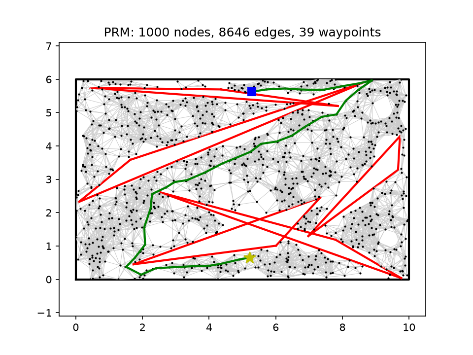
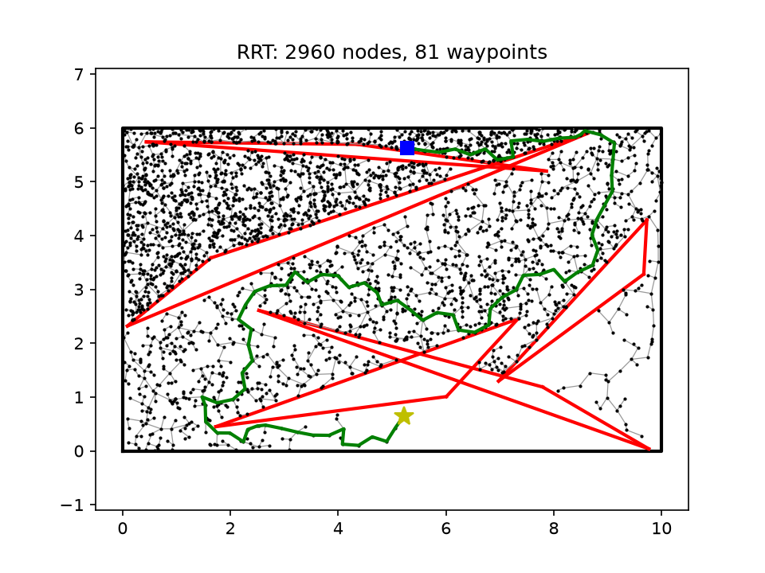
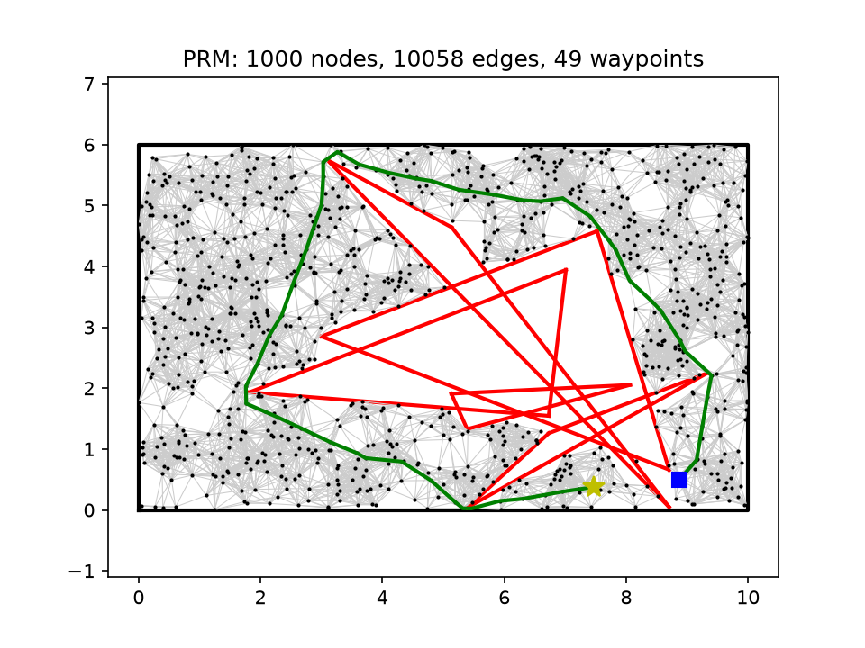
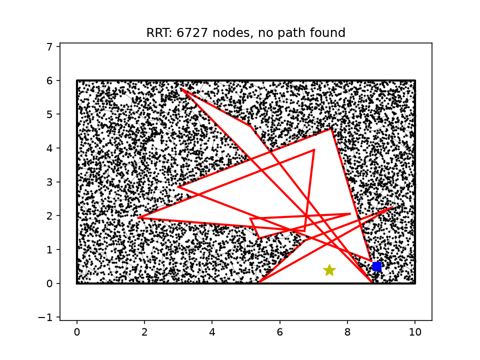
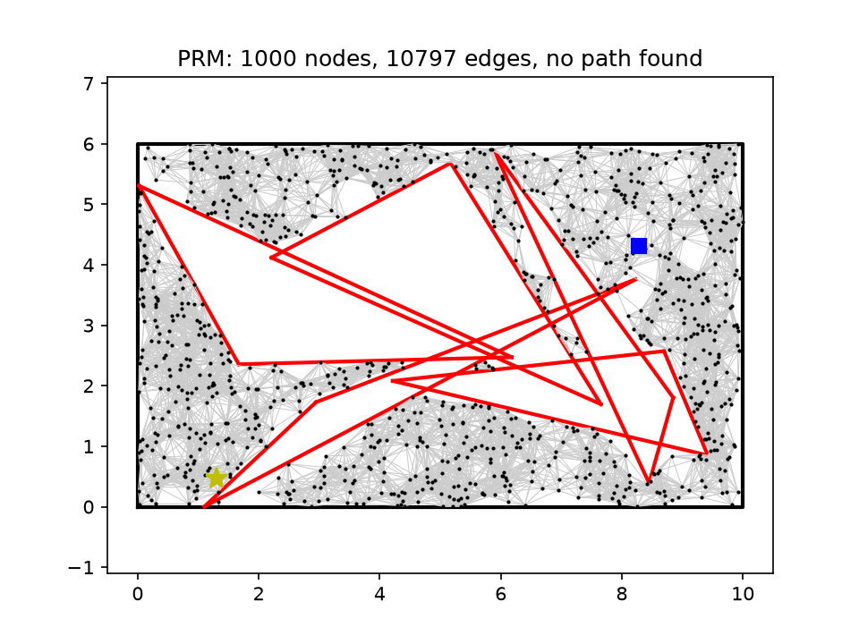
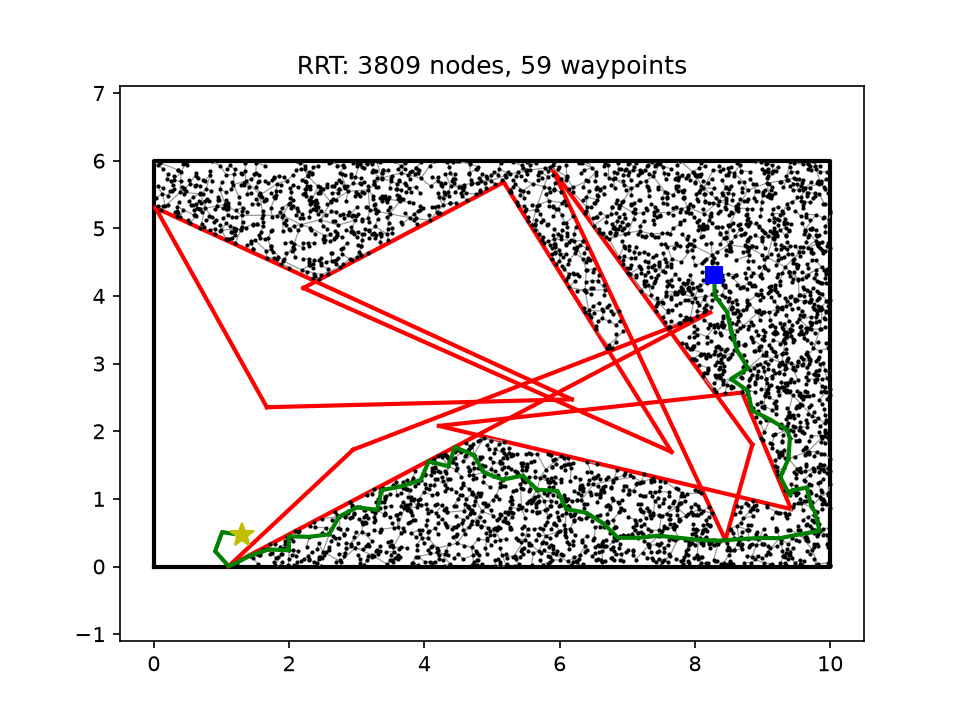
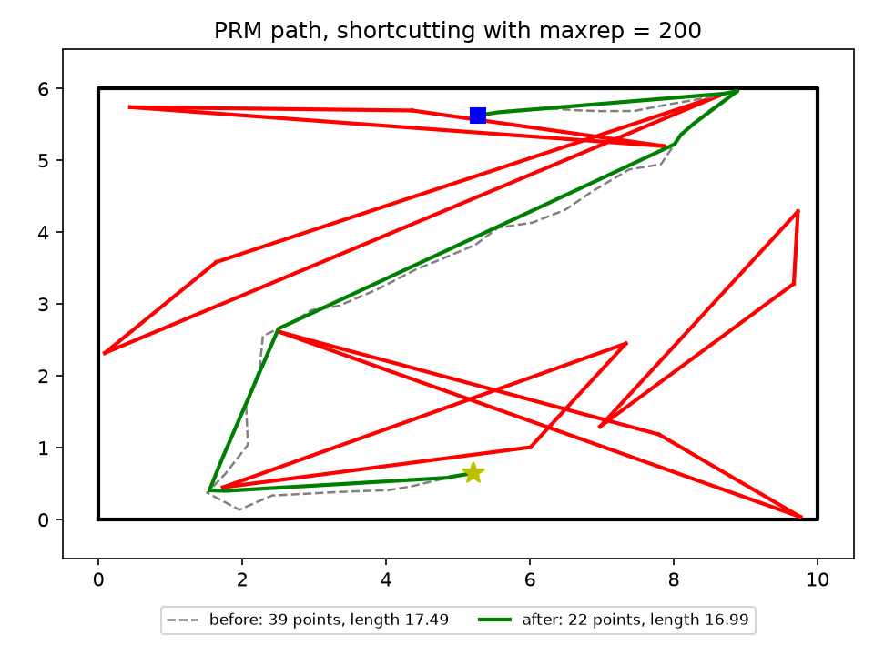
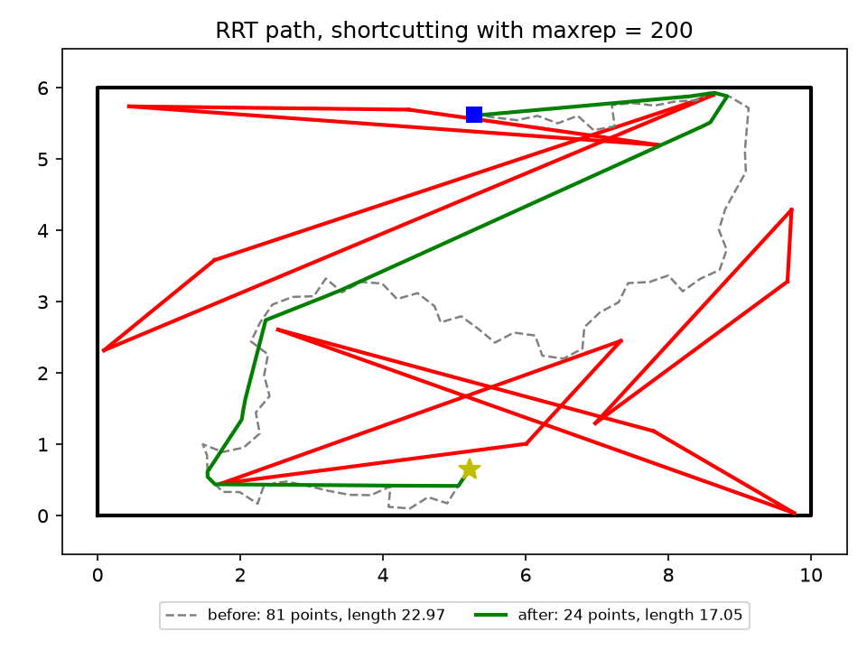
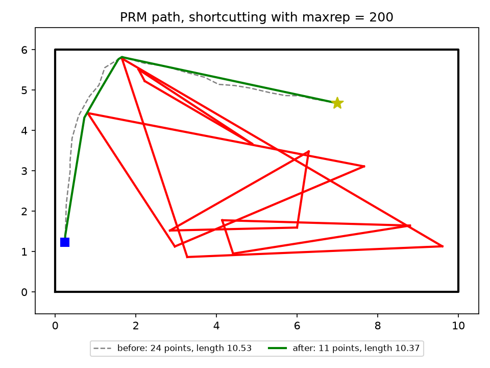
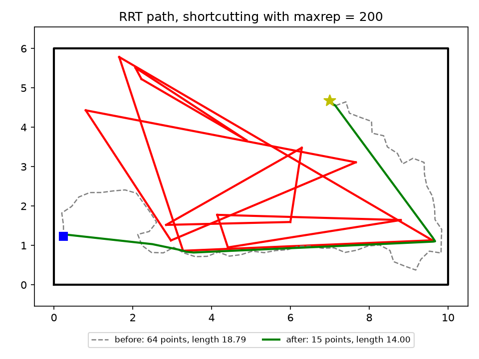

# 2D path planning: PRM, RRT and path shortcutting

Solutions to three exercises of the [Open Source Robotics course](https://crigroup.gitbooks.io/osrobotics/):

| # | Exercise | Course page |
|---|---|---|
| 1 | Solving a 2D motion planning problem by PRM | [Path planning](https://crigroup.gitbooks.io/osrobotics/content/planning/path_planning.html) |
| 2 | Solving a 2D motion planning problem by RRT, and comparing running times with PRM | [Path planning](https://crigroup.gitbooks.io/osrobotics/content/planning/path_planning.html) |
| 3 | Post-processing a 2D path (path shortcutting) | [Post-processing](https://crigroup.gitbooks.io/osrobotics/content/planning/post_processing.html) |

`environment_2d.py` is copied from [crigroup/osr_course_pkgs](https://github.com/crigroup/osr_course_pkgs/blob/master/osr_examples/scripts/environment_2d.py);

## Setup

Tested with Python 3.13.

```bash
python -m venv .venv
.venv\Scripts\activate # Windows
# On Linux/macOS: source .venv/bin/activate
pip install -r requirements.txt
```

## Running

| Exercise | Command | Output |
|---|---|---|
| 1 | `python exercise1_prm.py` | `results/prm_seed4.png` |
| 2 | `python exercise2_rrt.py` | `results/rrt_seed4.png` |
| 2 | `python exercise2_compare.py > results/compare.txt` | timing tables |
| 3 | `python exercise3_shortcut.py` | `results/shortcut_prm_seed4.png`, `results/shortcut_rrt_seed4.png` |

- The default seed 4 is the instance of the exercise (`np.random.seed(4)`, `Environment(10, 6, 5)`). Use `--seed N` for other environments and queries.
- `--no-show` saves the figure without opening a window.
- Run times (see [Collision checking](#collision-checking)): about 1 minute for exercise 1, 10 to 20 seconds for exercise 2, about 1.5 minutes for exercise 3 and about 13 minutes for `exercise2_compare.py`.
- All parameters are in [`planning/config.py`](planning/config.py).

## Project structure

```
exercise1_prm.py        exercise 1: PRM on one problem, prints and plots the result
exercise2_rrt.py        exercise 2: RRT on one problem, prints and plots the result
exercise2_compare.py    exercise 2: running time of PRM vs RRT
exercise3_shortcut.py   exercise 3: shortcutting of the PRM and RRT paths
environment_2d.py       course file: map, triangles, check_collision, random_query
planning/
    config.py           parameters
    problem.py          make_problem: seed -> environment and query
    collision.py        is_segment_free: env.check_collision on points of a segment
    sampling.py         sample_free (PRM), random_config (RRT)
    prm.py              build_roadmap, query, prm
    graph_search.py     dijkstra
    rrt.py              nearest, steer, build_rrt, extract_path, rrt
    path.py             path_length, point_at
    shortcut.py         shortcut
    plotting.py         plot_prm, plot_rrt, plot_shortcut
results/                figures and timing output
```

## Pipeline

Every script starts with `make_problem(seed)` ([problem.py](planning/problem.py)), which seeds numpy, builds the environment and draws a query, like the sample code of the exercise. Every straight segment is checked with `is_segment_free` ([collision.py](planning/collision.py)), see [Collision checking](#collision-checking).

### Exercise 1: PRM (`exercise1_prm.py`)

1. **Sample**: `sample_free` ([sampling.py](planning/sampling.py)) draws N random points and keeps those for which `env.check_collision` is False.
2. **Connect**: `build_roadmap` ([prm.py](planning/prm.py)) adds an edge between every pair of nodes closer than r whose segment is free. The roadmap is a graph `adj[i] = [(j, distance), ...]`.
3. **Query**: `query` ([prm.py](planning/prm.py))
   - returns the straight line if start-goal is free;
   - otherwise adds start and goal to a copy of the roadmap, connected the same way;
   - runs `dijkstra` ([graph_search.py](planning/graph_search.py)) from start to goal.
4. **Plot**: `plot_prm` ([plotting.py](planning/plotting.py)).

`prm()` runs steps 1 to 3 for a single query. For many queries on one environment, the roadmap is built once and `query` is called for each query (see `exercise2_compare.py`).

### Exercise 2: RRT (`exercise2_rrt.py`)

`build_rrt` ([rrt.py](planning/rrt.py)) follows BUILD_RRT and EXTEND from the course:

1. Return the straight line if start-goal is free (same check as PRM, so the timing comparison is fair).
2. Repeat up to MAX_ITER times:
   - `random_config` ([sampling.py](planning/sampling.py)): random point q_rand;
   - `nearest`: tree node q_near closest to q_rand;
   - `steer`: q_new is q_rand if it is within STEP_SIZE of q_near, otherwise the point at distance STEP_SIZE towards q_rand; fails if q_near-q_new is blocked;
   - add q_new with parent q_near; if goal is within STEP_SIZE of q_new and the segment is free, add goal and stop.
3. `extract_path` follows the parents from goal back to start.
4. `plot_rrt` ([plotting.py](planning/plotting.py)).

### Exercise 2: comparison (`exercise2_compare.py`)

- `single_query`: 10 seeds, each a new environment with one query. PRM builds a roadmap for each query, RRT grows one tree.
- `multi_query`: one environment (seed 4) with 20 queries. PRM builds the roadmap once and answers all 20 queries on it; RRT grows a new tree for each query.

### Exercise 3: path shortcutting (`exercise3_shortcut.py`)

1. Plan with PRM and RRT on the same problem. The problem is rebuilt before each planner, so the paths are the ones of exercises 1 and 2.
2. `shortcut` ([shortcut.py](planning/shortcut.py)), PATH_SHORTCUTTING from the course, repeated MAXREP times:
   - pick t1 < t2 uniformly in [0, path length];
   - `point_at` ([path.py](planning/path.py)) gives q(t1), q(t2) and the segments they lie on;
   - if q(t1)-q(t2) is free, replace the part of the path between them with this segment.
3. `plot_shortcut` ([plotting.py](planning/plotting.py)) draws the path before (dashed) and after (green).

### Collision checking

`is_segment_free` uses the method suggested by the exercise: it calls `env.check_collision` on points 0.001 apart (`COLLISION_STEP` in [config.py](planning/config.py)) along the segment. The environment is only used as an oracle that says whether a point is in collision.

This method has two limits:

- It can miss a triangle tip thinner than the step. A separate, finer check of the paths on seeds 0-9, 14 and 23 found that 1 of 22 planner paths and 4 of 22 shortcut paths cross a triangle tip; the piece inside the triangle is at most 0.0007 long. Shortcutting makes this more likely, because it pulls paths tight against corners. The seed 23 RRT path below is one of these cases.
- It is slow: a segment of length 0.6 needs about 600 calls of `check_collision`, so building one PRM roadmap (about 9000 candidate edges) takes about one minute.

An exact segment-triangle intersection test would fix both, but it needs the triangle geometry instead of only the `check_collision` oracle, so this solution keeps the method given in the exercise.

## Results

The same seed always gives the same paths. Running times depend on the machine.

### Exercises 1 and 2: sample problem (seed 4)

| PRM | RRT |
|---|---|
|  |  |
| 1000 nodes, 8646 edges; path of 39 points, length 17.49 | 2960 tree nodes; path of 81 points, length 22.97 |

- With N = 300 (r = 0.6 or 1.2), PRM finds no path on this problem: the free space has narrow gaps between triangle tips and the map border, and 300 samples rarely land in them. This is why N = 1000 (but the algo is much slower).
- The RRT tree also grows into the dead end at the top left: RRT expands towards large unexplored regions, whether or not they lead to the goal.

### Other environments

| seed | PRM | RRT |
|---|---|---|
| 14 | path of 49 points, length 20.23 | no path after 10000 iterations |
| 23 | no path | path of 59 points, length 16.34 (crosses a triangle tip, see below) |

| | PRM | RRT |
|---|---|---|
| Seed 14 |  |  |
| Seed 23 |  |  |

- Seed 14: the goal lies in a pocket closed by two overlapping triangles and the bottom border. The only entrances are gaps of about 0.04 under two triangle tips. PRM got through the left gap, with a long detour; RRT did not get in.
- Seed 23: PRM finds no path. RRT reaches the goal between a triangle tip and the bottom border near (1.1, 0), but a 0.0006-long piece of that segment lies inside the tip. This is shorter than the 0.001 sampling step, so the collision check missed it.
- Both planners are probabilistically complete: more samples or iterations make such gaps more likely to be found, at a higher cost.

### Exercise 2: running time ([`results/compare.txt`](results/compare.txt))

| | PRM | RRT |
|---|---|---|
| Single query, mean over 9 queries without a straight-line solution | 61.8 s | 2.6 s |
| 20 queries on one environment, total | 52.1 s (roadmap 49.2 s + queries 3.0 s) | 74.4 s |
| 20 queries on one environment, per query | 2.6 s | 3.7 s |

- Single query: RRT is about 24 times faster. PRM has to cover the whole free space with a roadmap, while RRT stops as soon as it reaches the goal.
- Multiple queries: PRM builds its roadmap once, and each extra query only costs connecting start and goal plus Dijkstra (about 0.15 s, against 3.7 s for a new RRT). PRM becomes faster in total from about 14 queries on, and the gap grows with every extra query.
- Almost all of the time is spent in collision checks, so the numbers scale with `COLLISION_STEP`.
- PRM found a path for 20/20 queries, RRT for 19/20.

### Exercise 3: path shortcutting (MAXREP = 200)

| seed | path | before | after |
|---|---|---|---|
| 4 | PRM | 17.49 (39 points) | 16.99 (22 points) |
| 4 | RRT | 22.97 (81 points) | 17.05 (24 points) |
| 5 | PRM | 10.53 (24 points) | 10.37 (11 points) |
| 5 | RRT | 18.79 (64 points) | 14.00 (15 points) |

| Seed 4, PRM | Seed 4, RRT |
|---|---|
|  |  |

| Seed 5, PRM | Seed 5, RRT |
|---|---|
|  |  |

- RRT paths zigzag, so shortcutting shortens them much more (26% on seed 4) than PRM paths, which are already shortest paths on the roadmap (3%). After shortcutting, both seed 4 paths have almost the same length.
- Shortcutting only changes a path locally. On seed 5 the RRT path passes an obstacle on the other side than the PRM path, so it stays longer (14.00 vs 10.37).

## Notes

- RRT is the basic single-tree version of the course. The bidirectional RRT mentioned in the text is not implemented.
- Changing `planning/config.py` and running a script again overwrites its figure in `results/`.
